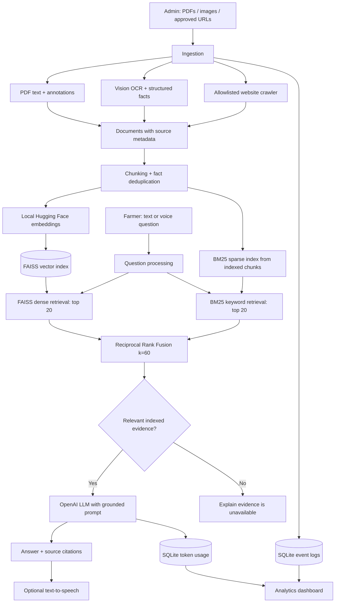

# 🌾 Tamil Nadu Agriculture AI Assistant

**A document-grounded, multilingual agriculture information assistant built with Python, Streamlit, LangChain, Hugging Face embeddings, FAISS, BM25, Reciprocal Rank Fusion, OpenAI, and LangSmith.**

The application helps farmers and agriculture stakeholders ask questions about crops, government schemes, subsidies, agricultural practices, and official announcements. Administrators build the knowledge base by uploading PDFs and images or supplying approved government URLs. The assistant retrieves relevant indexed evidence before generating an answer and shows source references.

> **Project status:** Functional application / production-oriented prototype. It is **not** an official Tamil Nadu government service, a guarantee of scheme eligibility, or a substitute for professional agronomic advice. Source quality, availability, and freshness must be reviewed before public deployment.

## 1. What the application does

| Feature | Technology / approach | Why we use it |
|---|---|---|
| Farmer-facing AI chat | Streamlit `st.chat_input`, chat messages | Simple browser-based interface without a separate frontend framework |
| Admin document upload | Streamlit multi-file uploader | Ingest several agriculture PDFs/images in one operation |
| PDF text and link extraction | `pypdf` | Extract selectable PDF text, URLs in text, and clickable PDF links |
| Image and infographic OCR | OpenAI vision model, Pillow | Read image-based announcements and multi-card budget graphics that ordinary PDF text extraction misses |
| Layout-aware extraction | Whole-image and overlapping image regions; structured fact records | Reduce mismatches between announcement titles and corresponding amounts |
| Website ingestion | `requests`, Beautiful Soup | Extract readable text and relevant scheme/document links from approved websites |
| Controlled multi-page crawling | Breadth-first link traversal with allowlisted domains, depth/page limits | Index linked government scheme pages without unrestricted web crawling |
| Document chunking | LangChain `RecursiveCharacterTextSplitter` | Create searchable passages while retaining source metadata |
| Multilingual embeddings | Hugging Face `paraphrase-multilingual-MiniLM-L12-v2` | Convert Tamil/English-oriented queries and documents to semantic vectors locally |
| Vector search | FAISS | Fast similarity search over indexed document chunks |
| BM25 sparse retrieval | `rank-bm25` over all indexed document chunks | Match exact scheme names, keywords, numbers, and Tamil/English text |
| Reciprocal Rank Fusion (RRF) | Combine top-20 FAISS and top-20 BM25 rankings, k=60 | Merge semantic and lexical evidence without comparing incompatible raw scores |
| Structured fact matching | Exhaustive structured-record listing for complete-list requests | Preserve all indexed budget records when the user asks for a complete list |
| RAG answer generation | LangChain prompt pipeline + OpenAI chat model | Answer using retrieved source material rather than relying only on model memory |
| Citations | Document metadata and `[Source N]` references | Make answers easier to verify against the original documents and URLs |
| Complete structured lists | Direct listing of indexed budget records | Avoid dropping entries when a user asks for all announcements or allocations |
| Voice questions | Streamlit audio-enabled chat input + OpenAI Whisper | Allow speech-to-text questions from users who prefer speaking |
| Read aloud | OpenAI text-to-speech | Offer audio playback of answers |
| Tracing | LangSmith `@traceable` | Inspect ingestion, web fetching, indexing, retrieval, and answer-generation steps when configured |
| Usage and operations analytics | SQLite, Pandas, Plotly | Review recorded API token usage, ingestion events, and charts |
| Chat navigation | Streamlit session state | Create and revisit conversations during the current Streamlit session |

### What is *not* currently implemented

- **BM25 + RRF hybrid retrieval is implemented.** Cross-encoder reranking and formal relevance benchmarks are not yet implemented.
- **No general-purpose audio/video file ingestion.** Audio is used for asking questions, not for building the document index.
- **No persistent, authenticated multi-user chat history.** Conversation threads are held in Streamlit session state.
- **No automatic website refresh or scheduled re-indexing.** Admins trigger ingestion manually.
- **No OCR fallback for scanned PDF pages without selectable text.** Image uploads use vision OCR, but scanned PDF pages may require a separate OCR pipeline.
- **No guaranteed exhaustive website crawl.** Relevance filters, access restrictions, redirects, and crawl limits can exclude pages.

## 2. Architecture



**RAG (Retrieval-Augmented Generation)** is used because government schemes, financial allocations, eligibility criteria, and deadlines are source-dependent and may change. The application retrieves relevant indexed evidence first and instructs the model to use that evidence for factual claims. This reduces—but does not eliminate—hallucinations.

## 3. Technology stack and rationale

| Layer | Library / service | Selection rationale |
|---|---|---|
| Language | Python | Broad support for document processing and AI libraries |
| UI | Streamlit | Fast delivery of a responsive chat and admin interface |
| LLM orchestration | LangChain Core / LangChain OpenAI | Reusable prompt templates, document objects, model invocation |
| Embeddings | `langchain-huggingface`, `sentence-transformers` | Local embedding inference; no separate embedding API key required |
| Vector store | `faiss-cpu`, `langchain-community` | Persistent local similarity index, straightforward prototyping |
| Sparse retrieval | `rank-bm25` | Exact keyword matching across all indexed chunks |
| Fusion | Custom Reciprocal Rank Fusion (RRF) | Combine ranked dense/sparse candidates, deduplicated by chunk ID |
| OCR / vision | OpenAI vision model, Pillow | Interpret screenshots, scanned images, and complex infographics |
| Chat generation | OpenAI `gpt-4o-mini` by default | Generate natural-language answers from retrieved context |
| Speech recognition | OpenAI `whisper-1` | Convert recorded questions to text |
| Speech output | OpenAI speech API | Read responses aloud when enabled |
| Website parsing | Requests + Beautiful Soup | Retrieve HTML/PDF and extract readable content/links |
| PDF parsing | `pypdf` | Text extraction and PDF hyperlink discovery |
| Monitoring | LangSmith | Trace decorated application operations when credentials are configured |
| Metrics storage | SQLite | Lightweight local persistence of ingestion events, feedback, and API usage |
| Visualizations | Plotly + Pandas | Token-usage charts and operational analysis |

**Cost note:** Local Hugging Face embeddings avoid per-request embedding API charges. OpenAI chat, image OCR, transcription, and speech synthesis may incur API costs. LangSmith may have separate usage/pricing terms.

## 4. Project structure

```text
agriculture-ai/
├── app.py                       # Main Streamlit application
├── .env                         # Local credentials (do not commit)
├── README.md
└── data/                        # Created at runtime
    ├── uploads/                 # Saved uploaded documents/images
    ├── faiss_index/             # Persistent FAISS index and model marker
    └── analytics.sqlite3        # Events, feedback and token usage
```

If your local filename is `AgricultureAI_Bot.py`, substitute that name for `app.py` in the commands below.

## 5. Installation

**Requirements:** Python 3.10+ recommended, internet access for initial model download and OpenAI calls, and a valid OpenAI API key. A recent Streamlit version is needed for the integrated audio-enabled chat composer.

```bash
python -m venv .venv
```

Activate the environment:

```bash
# Windows PowerShell
.venv\Scripts\Activate.ps1

# macOS / Linux
source .venv/bin/activate
```

Install dependencies:

```bash
pip install -U streamlit openai langchain-core langchain-openai \
  langchain-huggingface langchain-text-splitters langchain-community \
  sentence-transformers faiss-cpu rank-bm25 pypdf requests beautifulsoup4 \
  pillow pandas plotly langsmith python-dotenv streamlit-mic-recorder
```

> On Windows, run the install command on one line if your shell does not support backslash continuation. `streamlit-mic-recorder` is an optional compatibility dependency; the primary composer uses Streamlit's native audio input when supported.

### Configure environment variables

Create a `.env` file or use `.streamlit/secrets.toml`. The application reads environment variables and Streamlit secrets. **The application automatically loads `.env` from the same directory as `app.py`** when `python-dotenv` is installed. The equivalent manual configuration is:

```python
from dotenv import load_dotenv
load_dotenv()
```

Example `.env`:

```dotenv
OPENAI_API_KEY=your_openai_api_key
OPENAI_CHAT_MODEL=gpt-4o-mini
OPENAI_VISION_MODEL=gpt-4o
HF_EMBEDDING_MODEL=sentence-transformers/paraphrase-multilingual-MiniLM-L12-v2
AGRI_ALLOWED_DOMAINS=tn.gov.in,tnau.ac.in,agritech.tnau.ac.in,pmkisan.gov.in,icar.gov.in,agmarknet.gov.in,agricoop.nic.in

# Optional LangSmith tracing
LANGSMITH_TRACING=true
LANGSMITH_API_KEY=your_langsmith_api_key
LANGSMITH_PROJECT=tn-agriculture-ai
```

For Windows PowerShell, another option is to set environment variables in the shell before running Streamlit. Never commit API keys or secrets to Git.

Start the app:

```bash
streamlit run app.py
```

Open the local address displayed by Streamlit, typically `http://localhost:8501`.

## 6. Admin workflow: building the knowledge base

1. Open **Admin Configuration → Upload & Ingest**.
2. Upload one or more **PDF, PNG, JPG/JPEG, or WEBP** files; optionally enter approved website URLs, one per line.
3. Click **Process and index**.
4. The app extracts PDF text/links, runs image OCR, and discovers linked scheme pages and PDFs from approved roots.
5. Content is normalized, chunked, embedded locally, and saved into FAISS.
6. Review the extracted-text previews, indexing summary, and **Skipped/failed URLs** report.
7. Ask questions in **AI Assistance** and verify the displayed source references.

### Example: Tamil Nadu government scheme directory

```text
https://www.tn.gov.in/scheme_list.php?dep_id=Mg==
```

The crawler attempts to follow relevant scheme/document links from the supplied page. However, the source server may redirect a retired URL, block automated requests, or omit links from server-rendered HTML. The app reports failures rather than claiming those pages were indexed.

### Crawl and chunking defaults

| Setting | Default | Reason |
|---|---:|---|
| Chunk size | 900 characters | Balance retrievable context and specificity |
| Chunk overlap | 150 characters | Reduce loss of context at chunk boundaries |
| Fused top-k | 6 | Limit context passed to the chat model |
| FAISS candidate pool | 20 | Supply semantically relevant candidates to RRF |
| BM25 candidate pool | 20 | Supply exact-match candidates to RRF |
| RRF constant | 60 | Rank-based fusion without mixing incomparable raw scores |
| Crawl depth | 2 | Follow directory → scheme → document links |
| Maximum checked crawl URLs | 60 | Prevent uncontrolled ingestion |
| HTTP timeout | 15 seconds | Avoid hanging indefinitely on unresponsive sites |
| Maximum redirect hops | 5 | Avoid redirect loops |
| Maximum web text | 150,000 characters per page | Bound extracted page size |

These are constants in `app.py`, not currently exposed as admin controls.

### Add versus Replace

- **Add mode:** Appends newly processed chunks to the existing FAISS index. It does not guarantee global duplicate elimination across past runs.
- **Replace FAISS DB:** Rebuilds the index from the content successfully processed in the current run. Previously indexed sources not included in that run are no longer searchable.

**Important:** The application uses `FAISS.load_local(..., allow_dangerous_deserialization=True)`. Only load indexes produced and stored in a trusted, access-controlled location; do not import arbitrary FAISS index folders.

## 7. Farmer workflow: asking questions

Sample questions:

- What agriculture subsidies are available in Tamil Nadu?
- Explain the eligibility criteria for a scheme in the uploaded government document.
- List all budget allocations extracted from the uploaded agriculture infographic.
- What does the official document say about farm mechanisation?
- Summarize the linked government scheme and cite its source.

The assistant retrieves the top 20 semantic candidates from FAISS and top 20 lexical candidates from BM25 over the same indexed chunks. Unicode-aware tokenization supports Tamil and English words and numbers. Reciprocal Rank Fusion combines ranks using `score(d) = Σ 1/(60 + rank(d))`, deduplicates by `chunk_id`, and selects the top 6 fused chunks for grounded answer generation. BM25 is rebuilt from the persisted FAISS document store on first use and cached; ingestion invalidates the cache. Explicit complete-list requests retain the dedicated structured-record listing path. If there is no indexed evidence, the application explains that it cannot answer from the available sources.

**Why hybrid retrieval?** FAISS finds semantically related agricultural concepts; BM25 boosts exact scheme names, government order references, rupee amounts, and uncommon terms. RRF combines both without comparing FAISS distances against BM25 scores. This improves candidate diversity but does not guarantee that the answer is correct; citations and evaluation remain essential.

**Multilingual support:** The multilingual embedding model supports cross-language semantic matching, and the answer prompt asks the LLM to respond in the user's language where possible. Tamil accuracy depends on the input source, extraction quality, and model behavior; it requires evaluation with real farmer questions.

**Voice:** Supported Streamlit versions show a microphone in the chat composer. Speech is transcribed with Whisper before retrieval. The **Read aloud** toggle can generate speech for answers.

## 8. Accuracy and reliability measures

| Measure | Why it matters |
|---|---|
| Source-grounded prompt | Instructs the model not to invent official scheme facts |
| No-evidence response | Avoids confidently answering when the index has no relevant results |
| Source references | Allows verification of claims against original materials |
| Structured image facts | Keeps headings and amounts associated when parsing infographics |
| Deduplication within extracted fact sets | Reduces repeated OCR variants |
| Direct full-list rendering | Avoids LLM truncation for certain complete-list budget queries |
| Allowlisted URLs and public-IP checks | Reduce unintended requests to unapproved/private network targets |
| Redirect checks and crawl error reports | Surface inaccessible or misleading source pages |
| LangSmith traces | Help developers investigate which ingestion/retrieval step failed |

**Limitations:** Retrieved evidence can still be stale, irrelevant, incomplete, or incorrectly extracted. Citations do not automatically prove that an answer is correct. Administrators should verify sensitive advice, scheme deadlines, pesticide instructions, and financial figures against official current sources.

## 9. Analytics and observability

The **Data Analytics** page uses SQLite data to display recorded input/output token totals, model-call counts, operational events, and charts. Token figures are derived from usage metadata returned by the model provider when available; they are not synthetic estimates. A chart may appear empty before the first recorded API call.

LangSmith `@traceable` decorators instrument major steps such as PDF parsing, image OCR, web fetching/crawling, structured extraction, indexing, retrieval, and answer generation. Set `LANGSMITH_TRACING=true`, `LANGSMITH_API_KEY`, and optionally `LANGSMITH_PROJECT` to enable remote tracing. **Tracing is separate from the local SQLite dashboard.**

## 10. Security and deployment considerations

Before exposing the app publicly, implement authentication and role-based access for admin ingestion; per-user data isolation; rate limits; robust content size limits; secrets management; network egress controls; document and URL content validation; privacy and retention policies; backups; monitoring; and scheduled source-refresh procedures.

The current URL allowlist and public-IP validation are useful safeguards but **not a complete SSRF protection boundary**, especially across DNS changes or complex network infrastructure. Enforce network restrictions at deployment level as well. External web pages and PDFs are untrusted inputs, even when hosted on an approved domain.

The application uses local FAISS and SQLite storage. For multiple replicas, concurrent ingestion, or large-scale deployment, evaluate durable object storage, a managed database, background ingestion workers, a shared vector service, and formal retrieval/answer-quality evaluations.

## 11. Troubleshooting

| Issue | What to check |
|---|---|
| `OPENAI_API_KEY` missing | Set the key in Streamlit secrets or export the environment variable; `.env` is not auto-loaded by current code |
| Microphone missing | Upgrade Streamlit to a version with `st.chat_input(accept_audio=True)` |
| Website has no indexed pages | Check redirect, HTML content, allowed domains, relevant link labels, and failed-URL report |
| Scanned PDF has no text | Convert pages to images for OCR or add a scanned-PDF OCR pipeline |
| FAISS embedding model mismatch | Rebuild the index after changing `HF_EMBEDDING_MODEL` |
| Empty analytics charts | Make a model request; check SQLite usage records and Plotly installation |
| Slow first query/index | Initial Hugging Face model download and CPU embedding computation can take time |
| Missing scheme in answer | Confirm its source was fetched, extracted, indexed, and retrieved; top-k retrieval is not exhaustive |

## 12. Recommended next enhancements

1. Add **cross-encoder reranking** and benchmark BM25/FAISS/RRF retrieval quality on representative Tamil and English farmer questions.
2. Add **OCR for scanned PDF pages** and document-aware table extraction.
3. Add **scheduled website refresh**, source versioning, and stale-content warnings.
4. Add **persistent multi-user conversations**, admin authentication, and role-based permissions.
5. Add **background ingestion queues** with progress tracking and retry policies.
6. Add **automated RAG evaluations** for citation correctness, completeness, Tamil language quality, and hallucination rate.
7. Add structured ingestion for **audio/video content** if needed.

---

**Purpose:** Make official agriculture information easier to discover and understand while keeping the original source documents central to the answer.
